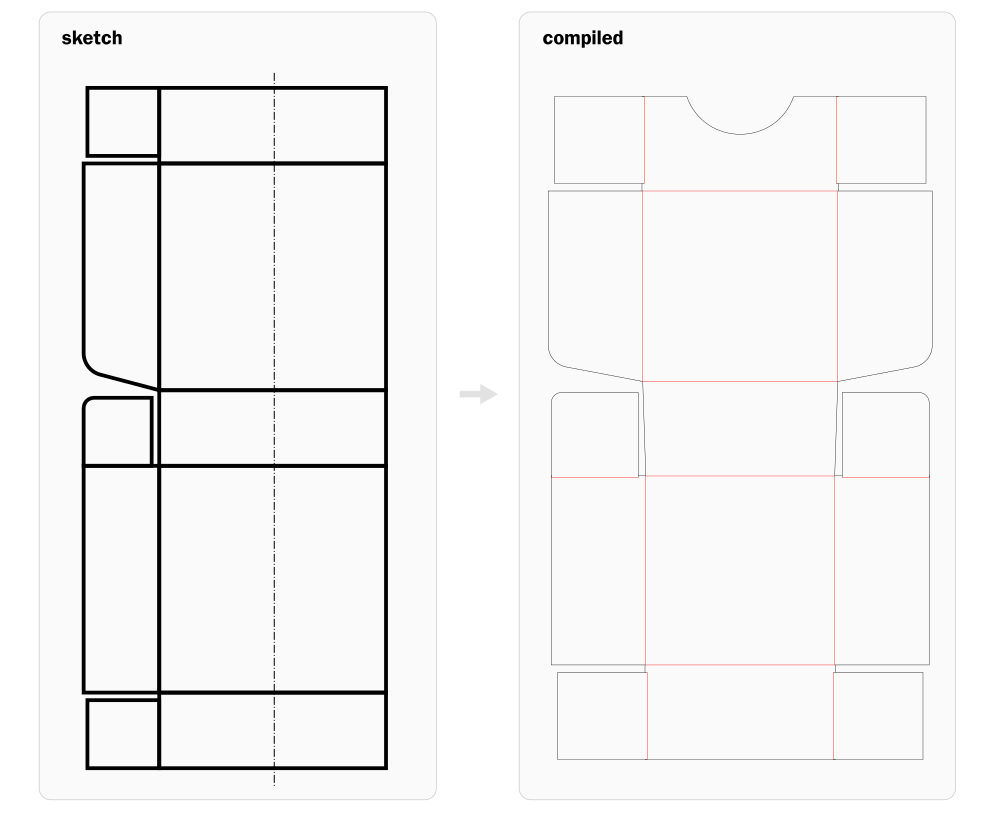

# Boxxer

Turn SVG box sketches into cut and score paths for a plotter. Draw separate
panels in Inkscape, or start with a preset; Boxxer finds the folds, resizes the
box, and accounts for material thickness.



**Pinwheel tray:** [editable sketch](presets/tray_gusset_self-locking_pinwheel.svg) →
[compiled SVG](examples/pinwheel-tray.svg). One corner and a 90° repeat marker
produce the complete net, with thickness allowance and two finger cutouts.

## Get started

You need Python 3.11+ and [uv](https://docs.astral.sh/uv/).

```sh
uv sync
uv run boxxer interactive
```

The keyboard-driven wizard lets you choose a sketch, set dimensions and paper thickness, and
optionally add finger cutouts. It writes a compiled SVG or DXF ready to open in your
plotter software and shows the equivalent CLI command so you can repeat it later.
Use `--plain` for simple text prompts; piped input selects them automatically.
Enter accepts faint defaults; typing replaces them. Shift+Tab goes back, and the
final review lets you edit a setting before generating.

For the command line:

```sh
uv run boxxer compile presets/tray_gusset_self-locking_pinwheel.svg --snap-near \
  --thickness 0.4 --finger-cutout opposing --output box.svg
```

Add `--with-lid` to generate a matching telescoping lid alongside a single tray
in the same output. The lid keeps the tray's construction and expands to fit the
folded material layers; use `--lid-height` to give it a different wall height.

Draw adjoining panels with shared edges for folds. Boxxer also supports signed
folds, mirror and rotational symmetry, and editable rounded corners. Output has
black cuts, red front-side scores, and blue dashed backside scores.

### How Boxxer works, simply

Think of the SVG as pieces of paper laid flat. Each closed shape is a piece;
where two pieces share an edge, that edge is a fold. Boxxer follows those
connections and virtually hinges the pieces into shape. That lets it work out
which flaps meet which walls, then adjust the drawing for box size and paper
thickness before making the cut and score paths.

The same idea works for many nets, without Boxxer knowing the sketch's filename
or requiring panel names. Today, resizing is tuned for rectangular box bases and
recognized wall layouts; it does not automatically handle every folded-paper
mechanism. See the [design guide](docs/design.md) for how virtual folding works
and where the model generalizes.

For Silhouette Studio Basic, use an output filename ending in **`.dxf`**. DXF
uses millimetres and separate black/red/blue cut and score layers. In Studio,
import at original size (not “Fit to Page”) and use **Send → Line** to assign
operations by colour. DXF score geometry is continuous, including backside scores.

To turn an editable draft into a reusable preset, repair its shared edges and
embed technical metadata.

Shared edges can cover only part of a wall or flap. Near-edge repair defaults
to 0.1 mm; use `--near-distance` to choose another tolerance.

```sh
uv run boxxer prepare draft.svg --output presets/tray_gusset_self-locking_pinwheel.svg
```

See **[the design guide](docs/design.md)** for drawing conventions, all options,
geometry details, and current limits. Run `uv run boxxer --help` for commands.

## Development

Code lives in `src/boxxer/`, tests in `tests/`, and editable presets in `presets/`.

```sh
uv run python -m unittest -v
```
